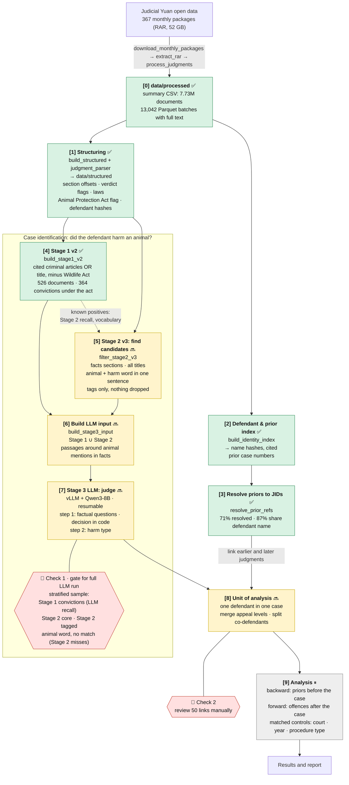

# Pipeline Flow

From raw open data to analysis. Renders on GitHub and in VS Code's Markdown preview.
Status and commands: see *Current State* in [DEVLOG.md](DEVLOG.md). Update this diagram
whenever a step's status or design changes.

Legend: ✅ done · 🔄 needs re-run · 🔜 next · ⏸ paused · 🧪 manual check (gate)

Division of work in case identification:
- **Stage 2 finds candidates, it does not judge them.** Deterministic and recall-oriented.
  It removes only text that cannot be facts (non-facts sections, fixed boilerplate,
  legal-norm sentences). Likely noise (nicknames, an owner's dog biting someone,
  pigeon ransom) is tagged, not dropped.
- **Stage 3 makes every judgment.** The LLM answers factual questions; whether a case
  counts (scope) is decided in code from those answers, so scope changes need no re-run.
- **Check 1 tests both**, with a sample stratified by source and tag.

## Outputs by step

| Step | Output |
|---|---|
| 0 | `data/processed/*_summary.csv`, `data/processed/*_batch*.parquet` |
| 1 | `data/structured/*.parquet` |
| 2 | `data/index/defendants.parquet`, `name_freq.parquet`, `prior_case_refs.parquet`, `court_names.parquet` |
| 3 | `data/index/prior_case_refs_resolved.parquet` |
| 4 | `data/filtered/stage1_v2.csv` |
| 5 | `data/filtered/stage2_v3.csv`, `stage2_v3_stage1_missed.csv`, `stage2_v3_animal_no_match.csv` |
| 6 | `data/filtered/stage3_input.parquet` |
| 7 | `data/verified/stage3_<model>.csv` (+ `_labels.csv`, resumable), gold set `data/labels/gold_v0.csv` |

Test runs write the same names with a `_test` suffix.

## Known coverage limit

About two thirds of summary judgments that say their facts are in the attached indictment
do not publish the attachment. Stage 2 cannot see those facts; such cases are found only
when they cite the Animal Protection Act (Stage 1). Stage 2 reports the count
(`facts_by_reference_only`).
| 9 | `data/analysis/` (exploratory so far) |
